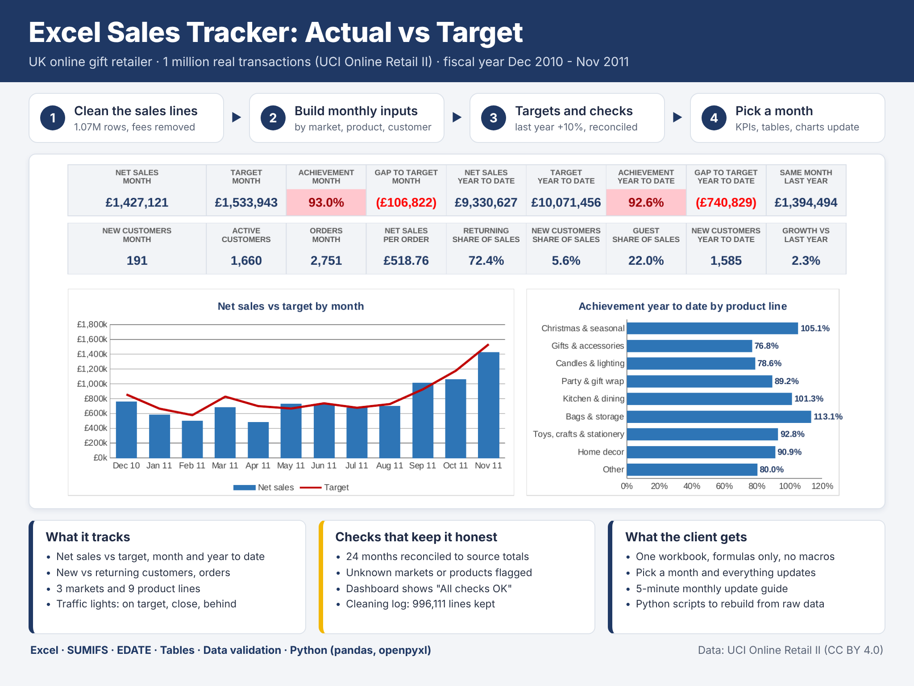
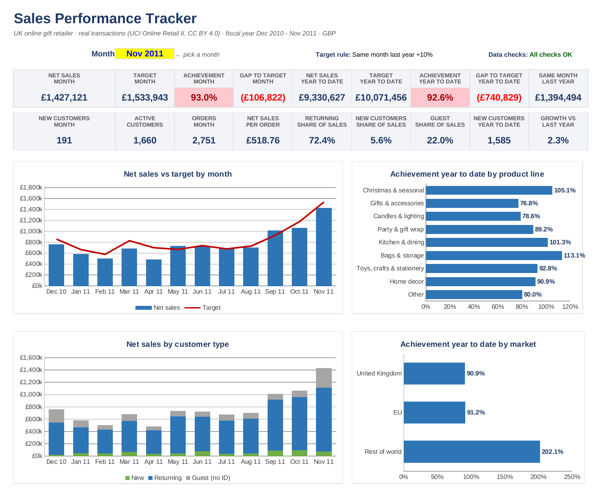
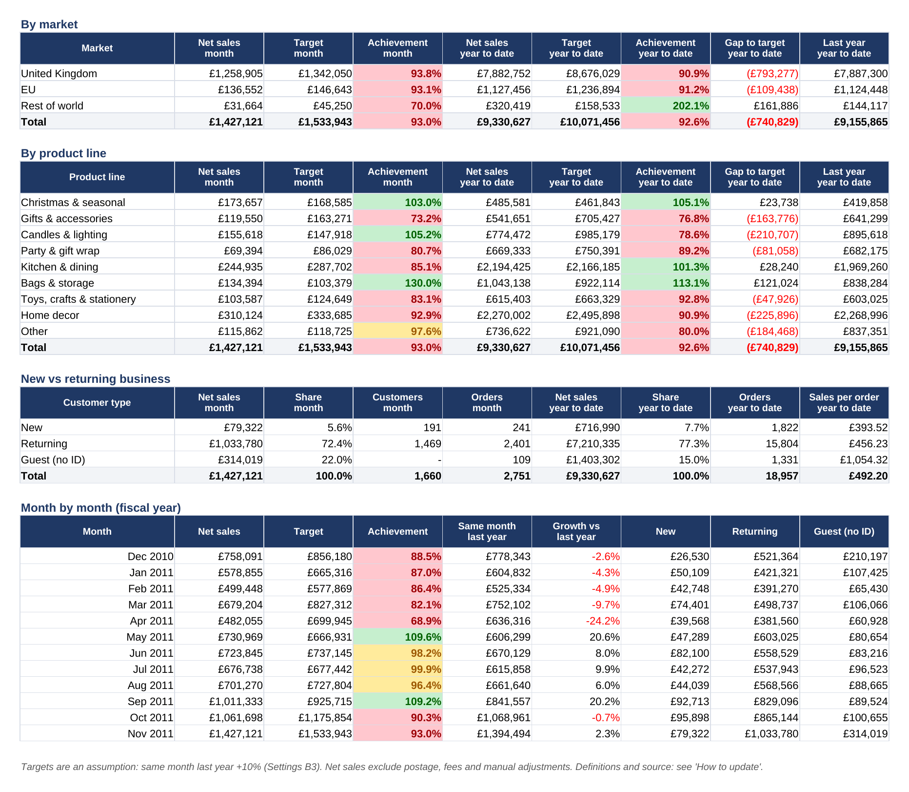
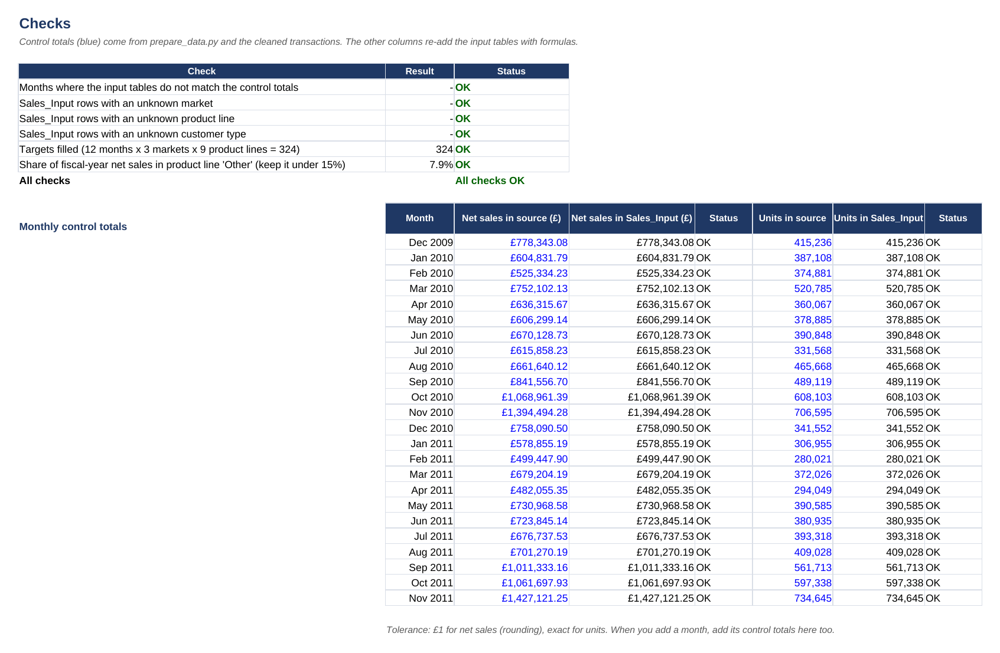

# Sales Performance Tracker (Excel)

A monthly sales tracker in Excel, built on **real public data**: 24 months of transactions from a UK online gift retailer ([UCI "Online Retail II"](https://archive.ics.uci.edu/dataset/502/online+retail+ii), CC BY 4.0).

Pick a month from the drop-down and the dashboard shows net sales against target, year-to-date progress, new vs returning customers, and achievement by market and product line.

**[Download the workbook](Sales_Performance_Tracker.xlsx)** · no macros · every number is a formula



## What it does

- **One month selector drives everything.** KPIs, tables and charts all follow the month picked in cell C4.
- **KPIs for the month and year to date:**
  - net sales, target, achievement and gap to target
  - same month last year and growth
  - new and active customers, orders, net sales per order
  - share of sales from returning, new and guest customers
- **Breakdowns by market and product line.** Markets are UK, EU and rest of world; there are 9 product lines. Achievement uses traffic lights: green at 100% or more, amber from 95% to 99.9%, red below 95%.
- **Targets follow one transparent rule:** same month last year plus a growth % held in one input cell. To use your own targets, type them over one column.
- **Built-in checks.** Every month is reconciled to control totals from the source data (net sales and units), and rows with unknown categories are flagged. The dashboard shows "All checks OK".
- **100% formulas, with no hardcoded results.** It uses SUMIFS, EDATE, Excel tables, data validation and conditional formatting. Paste next month's rows and everything updates.





## What the data shows (fiscal year Dec 2010 - Nov 2011)

- **Net sales grew but missed target.** Net sales were £9.33M, up 1.9% on the year before. That is 92.6% of a +10% target, a gap of £741k.
- **The UK was flat; rest of world doubled.** The UK is 84.5% of sales and moved -0.1% year on year. Rest of world more than doubled: £320k against £144k (+122%).
- **Returning customers drive the business.** They brought 77% of net sales; new customers brought 7.7%.
- **Product lines split above and below target:**
  - Bags & storage (113%) and Christmas & seasonal (105%) beat target.
  - Gifts & accessories (77%) and Candles & lighting (79%) fell furthest short.

## Checks



## Data source and changes

- **Dataset:** "Online Retail II" by Daqing Chen, UCI Machine Learning Repository (2019). DOI [10.24432/C5CG6D](https://doi.org/10.24432/C5CG6D). License: [CC BY 4.0](https://creativecommons.org/licenses/by/4.0/).
- **What it contains:** real transactions of a UK-based online retailer from 1 Dec 2009 to 9 Dec 2011. It sells mostly all-occasion giftware, and many of its customers are wholesalers.
- **Changes made here:** the transactions were cleaned and aggregated to monthly totals by market, product line and customer type. The raw file is not in this repository; download it from UCI.

| Cleaning step | Rows |
|---|---:|
| Rows in source (both sheets) | 1,067,371 |
| Exact duplicate rows removed (including 1-9 Dec 2010, which appears in both sheets) | 34,335 |
| Non-product lines removed (postage, fees, manual adjustments, samples, tests, gift vouchers) | 5,866 |
| Lines with price 0 or below removed (stock adjustments) | 5,960 |
| Lines outside full months removed (1-9 Dec 2011) | 25,099 |
| **Lines kept** | **996,111** |

## Definitions

- **Net sales:** quantity × unit price, minus returns (invoices starting with C).
- **Target:** same month last year × (1 + growth). The 10% growth is an assumption used to show the tracker at work; it is not a figure from the data.
- **Achievement:** net sales / target.
- **Gap:** net sales - target.
- **Customer types:**
  - New: the customer's first purchase in the data falls in that month.
  - Returning: the customer bought in an earlier month.
  - Guest: an order with no customer ID.
  - Because the data starts in Dec 2009, a customer whose earlier purchases predate the data counts as new.
- **Market:** United Kingdom, EU (member states in 2010-2011) or rest of world.
- **Product line:** set by keyword rules on the product description. The rules are listed on the Mapping tab. About 8% of sales match no rule and fall in "Other".

## Monthly update (about 5 minutes)

1. Export last month's transactions (invoice, product, quantity, unit price, customer, country, date).
2. Run `python prepare_data.py <export file> data`.
3. Paste the new rows under the last row of `Sales_Input` and `Customers_Input`, and the control totals under the last row of `Checks`.
4. Pick the month in Dashboard cell C4.
5. Check that the Checks tab says "All checks OK".

## Rebuild from the source data

```bash
pip install -r requirements.txt
python prepare_data.py online_retail_II.xlsx data
python build_workbook.py data Sales_Performance_Tracker.xlsx
```

Excel calculates the formulas when the file opens.

## Repository

```
Sales_Performance_Tracker.xlsx   the tracker
prepare_data.py                  cleans the transactions and writes the monthly inputs
build_workbook.py                builds the workbook (formulas, tables, checks, charts)
data/                            monthly inputs, control totals, cleaning log, mappings
*.png                            screenshots
```

**Tools:** Excel (SUMIFS, EDATE, tables, data validation, conditional formatting, charts) and Python (pandas, openpyxl).
